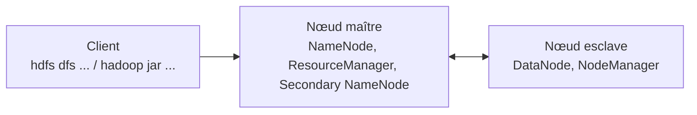
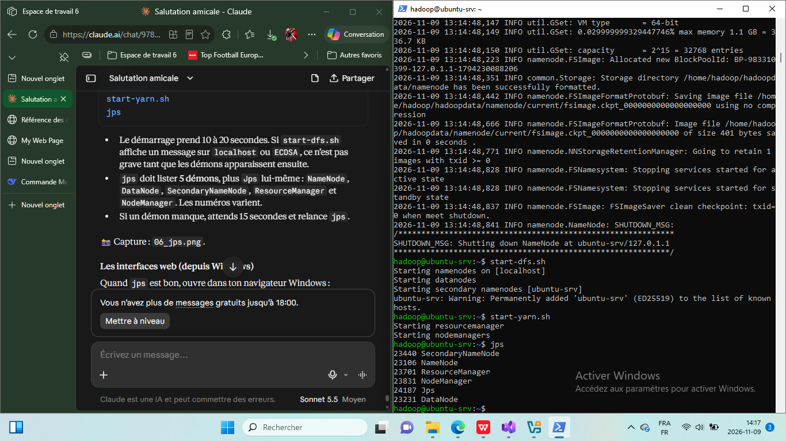
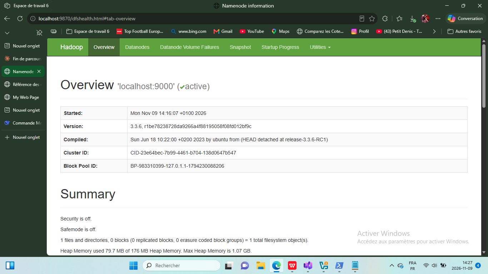
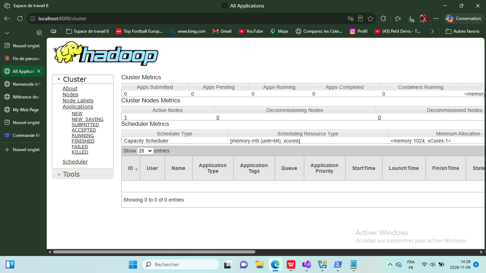
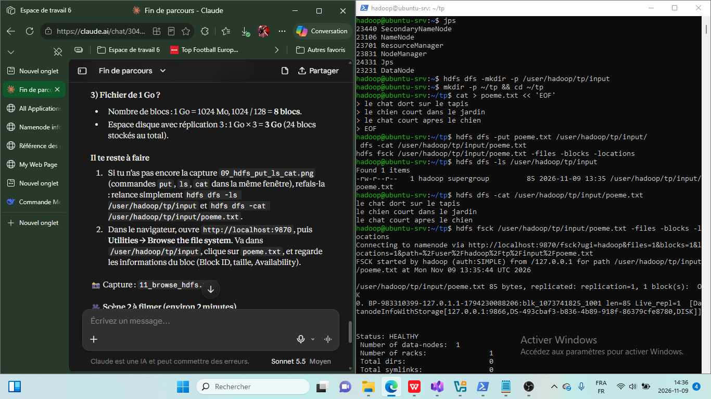
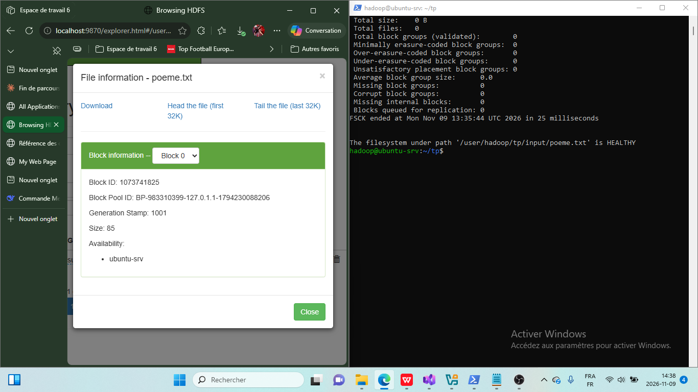
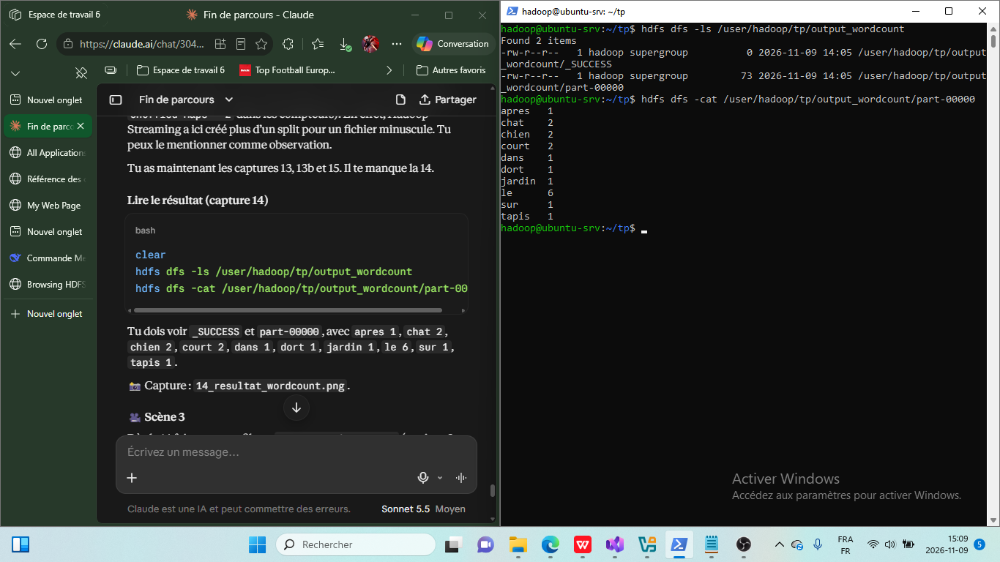
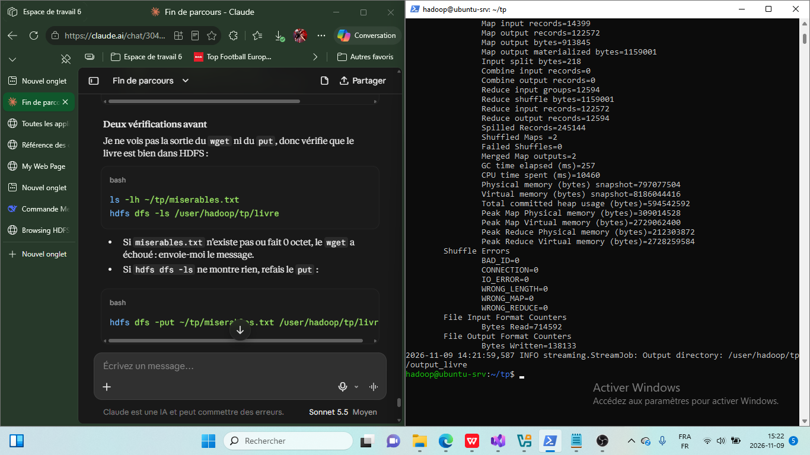
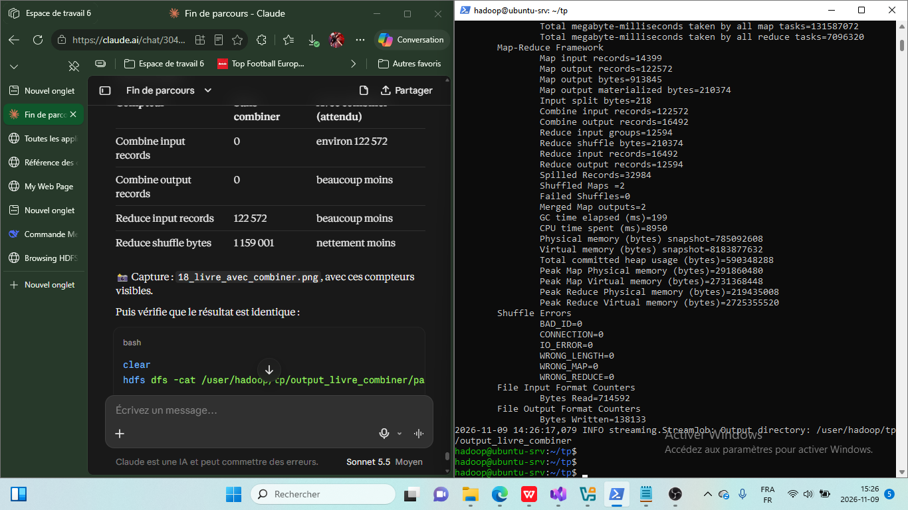
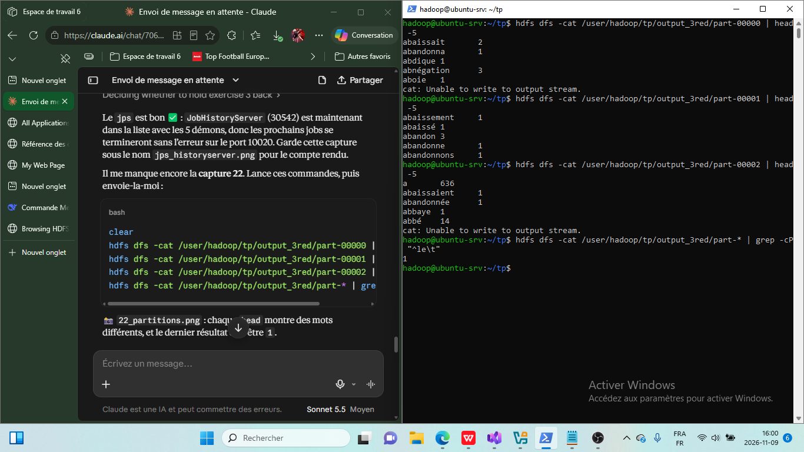

<p align="center">
  
</p>

# TP Hadoop sous Ubuntu : HDFS, YARN et MapReduce en Python

**Université Félix Houphouët-Boigny** · Licence 3 Mathématiques-Informatique, parcours BDGL

| | |
|---|---|
| **Étudiant** | TRA BI TRA Christian David |
| **Encadreur** | Docteur BAKAYOKO |
| **Date** | 9 novembre 2026 |

🎥 **Vidéo de présentation :** collez ici votre lien

Ce dépôt contient la réalisation du TP *« Hadoop sous Ubuntu : clusters, MapReduce et programmation en Python »* : installation d'Hadoop 3.3.6 en mode pseudo-distribué, manipulation de HDFS, puis six exercices MapReduce écrits en Python avec Hadoop Streaming. Le compte rendu détaillé est dans [`docs/compte_rendu.md`](docs/compte_rendu.md).

## Sommaire

1. [Présentation et environnement](#1-présentation-et-environnement)
2. [Définitions des termes importants](#2-définitions-des-termes-importants)
3. [Installation et démarrage du cluster](#3-installation-et-démarrage-du-cluster)
4. [HDFS : exercice 1](#4-hdfs--exercice-1)
5. [Le modèle MapReduce et Hadoop Streaming](#5-le-modèle-mapreduce-et-hadoop-streaming)
6. [Exercices 2 à 6 et résultats](#6-exercices-2-à-6-et-résultats)
7. [Difficultés rencontrées](#7-difficultés-rencontrées)
8. [Structure du dépôt](#8-structure-du-dépôt)
9. [Conclusion](#9-conclusion)

---

## 1. Présentation et environnement

**Objectifs :** installer Hadoop en mode pseudo-distribué, stocker des fichiers dans HDFS, puis écrire, tester et exécuter des programmes MapReduce en Python.

| Élément | Valeur |
|---|---|
| Machine virtuelle | VirtualBox, `ubuntu-srv` (2 CPU, 5 096 Mo de RAM, réseau NAT) |
| Système | Ubuntu 26.04.1 LTS |
| Java | OpenJDK 11.0.32.1 |
| Hadoop | 3.3.6, mode pseudo-distribué (1 DataNode, `dfs.replication=1`) |
| Python | 3 (Hadoop Streaming) |
| Accès depuis Windows | redirections de ports NAT : SSH 2222→22, HDFS 9870, YARN 8088, DataNode 9864 |

### Architecture d'un cluster Hadoop



Dans ce TP, le maître et l'esclave sont sur la même machine (mode pseudo-distribué) et la réplication vaut 1.

---

## 2. Définitions des termes importants

### Cluster et architecture

| Terme | Définition |
|---|---|
| **Cluster** | Ensemble d'ordinateurs indépendants (les nœuds), reliés par un réseau rapide et coordonnés par un logiciel, qui fonctionnent comme un seul système. |
| **Nœud** | Une machine du cluster, avec son propre processeur, sa mémoire et son disque. |
| **Nœud maître / esclave** | Le maître coordonne le cluster et connaît l'emplacement des données. Les esclaves (workers) stockent les données et exécutent les calculs. |
| **Scalabilité verticale (scale-up)** | Rendre une machine plus puissante (plus de CPU, de RAM). Elle atteint vite un plafond. |
| **Scalabilité horizontale (scale-out)** | Ajouter des machines au cluster. C'est le modèle utilisé par Hadoop. |
| **Mode pseudo-distribué** | Tous les démons Hadoop tournent sur une seule machine, chacun dans son propre processus. C'est le mode de ce TP. |
| **Démon** | Processus qui tourne en arrière-plan (par exemple NameNode ou DataNode). |
| **Localité des données** | Principe qui consiste à envoyer le programme (petit) vers les nœuds qui stockent les données (volumineuses), plutôt que l'inverse. |
| **Heartbeat** | Signal de vie envoyé régulièrement par un nœud pour dire qu'il fonctionne. |

### Hadoop et HDFS

| Terme | Définition |
|---|---|
| **Apache Hadoop** | Framework libre, écrit en Java, qui permet de stocker et de traiter de très gros volumes de données sur un cluster de machines ordinaires. |
| **Modules d'Hadoop** | Quatre modules : *Hadoop Common* (bibliothèques partagées), *HDFS* (stockage), *YARN* (ressources et ordonnancement) et *MapReduce* (modèle de calcul et moteur d'exécution). |
| **HDFS** | Hadoop Distributed File System : système de fichiers distribué et tolérant aux pannes. |
| **Bloc** | Fragment d'un fichier HDFS. Taille par défaut : 128 Mo. Un petit fichier n'occupe que sa taille réelle. |
| **Facteur de réplication** | Nombre de copies de chaque bloc (3 par défaut, 1 dans ce TP car il n'y a qu'une machine). |
| **NameNode** | Démon maître de HDFS : il gère l'arborescence et sait sur quels DataNodes se trouve chaque bloc. Il ne stocke aucune donnée utilisateur. |
| **DataNode** | Démon esclave de HDFS : il stocke les blocs et les sert aux clients. |
| **Secondary NameNode** | Fusionne périodiquement le journal des modifications (`edits`) avec l'image du système (`fsimage`). Ce n'est pas un NameNode de secours. |
| **fsimage / edits** | Métadonnées du NameNode : l'image du système de fichiers et le journal de ses modifications. |
| **fsck** | Commande `hdfs fsck` qui vérifie l'état d'un fichier HDFS : blocs, emplacements, santé (HEALTHY). |

### YARN

| Terme | Définition |
|---|---|
| **YARN** | Yet Another Resource Negotiator : gestionnaire des ressources (CPU, mémoire) et ordonnanceur des applications. |
| **ResourceManager** | Démon maître de YARN : il arbitre les ressources du cluster et accepte les applications soumises. |
| **NodeManager** | Démon esclave de YARN : il lance et surveille les conteneurs sur son nœud. |
| **ApplicationMaster** | Un par application : il négocie les ressources et pilote les tâches Map et Reduce de son job. |
| **Conteneur** | Unité d'allocation de YARN (de la mémoire et des cœurs) dans laquelle s'exécute une tâche. |
| **Job / application** | Un traitement soumis au cluster, par exemple un WordCount. Il apparaît dans l'interface YARN (port 8088). |
| **JobHistory Server** | Démon qui conserve l'historique des jobs terminés (port 10020). Sans lui, le client affiche une erreur en fin de job. |

### MapReduce

| Terme | Définition |
|---|---|
| **MapReduce** | Modèle de programmation qui traite de gros volumes de données en parallèle avec deux fonctions écrites par le développeur : map et reduce. |
| **Paire clé/valeur** | Forme sous laquelle circulent toutes les données : `(clé, valeur)`. La clé détermine le regroupement. |
| **Split** | Fragment du fichier d'entrée, en général un par bloc, confié à une tâche Map. |
| **Map (mapper)** | Fonction qui transforme chaque enregistrement d'entrée en paires `(clé, valeur)`. |
| **Combine (combiner)** | Mini-réduction locale à la sortie de chaque Map, pour diminuer le volume transféré. Utilisable seulement si l'opération est associative et commutative. |
| **Partition** | Affectation de chaque clé à un reducer (par défaut : hachage de la clé modulo le nombre de reducers). |
| **Shuffle & Sort** | Transfert des paires vers les reducers, puis tri et regroupement par clé : `(clé, [v1, v2, …])`. |
| **Reduce (reducer)** | Fonction qui agrège la liste des valeurs associées à une même clé. |
| **Opération associative et commutative** | Opération dont le résultat ne dépend ni du regroupement ni de l'ordre des valeurs (somme, maximum). La moyenne n'en est pas une. |
| **Hadoop Streaming** | Outil qui permet d'écrire le mapper et le reducer dans n'importe quel langage (ici Python) lisant `stdin` et écrivant sur `stdout`. |
| **Compteurs (counters)** | Statistiques affichées en fin de job : Map input records, Reduce input groups, Combine output records, etc. |
| **`part-0000X` et `_SUCCESS`** | Fichiers de sortie : un `part-0000X` par reducer, et un fichier vide `_SUCCESS` si le job a réussi. |
| **Index inversé** | Structure qui associe à chaque mot la liste des fichiers qui le contiennent. |

### Les phases d'un job MapReduce

| Phase | Qui | Rôle |
|---|---|---|
| 1. Input / Split | Hadoop | Le fichier d'entrée est découpé en splits (en général un par bloc). Chaque split est confié à une tâche Map. |
| 2. Map | Développeur | Chaque ligne est transformée en paires `(clé, valeur)`. Les tâches Map tournent en parallèle, de préférence là où est le bloc. |
| 3. Combine (facultatif) | Développeur | Mini-réduction locale à la sortie de chaque Map, pour diminuer les données transférées. |
| 4. Partition | Hadoop | Chaque clé est affectée à un reducer (hachage de la clé modulo le nombre de reducers). |
| 5. Shuffle & Sort | Hadoop | Les paires sont transférées vers les reducers, triées et regroupées par clé : `(clé, [v1, v2, …])`. |
| 6. Reduce | Développeur | Pour chaque clé, la fonction reduce agrège la liste des valeurs. |
| 7. Output | Hadoop | Les résultats sont écrits dans HDFS : un fichier `part-0000X` par reducer. |

### Outils utilisés

| Terme | Définition |
|---|---|
| **SSH** | Protocole de connexion sécurisée à une machine. Hadoop l'utilise pour démarrer les démons, d'où la clé sans mot de passe. |
| **`JAVA_HOME`** | Variable d'environnement qui indique où Java est installé (ici OpenJDK 11). |
| **`jps`** | Commande qui liste les processus Java en cours, donc les démons Hadoop actifs. |
| **`hdfs dfs`** | Commandes de manipulation de HDFS (`-mkdir`, `-put`, `-ls`, `-cat`…). |

---

## 3. Installation et démarrage du cluster

| # | Étape | Détail |
|---|---|---|
| 1 | Java 11 | OpenJDK 11, vérifié par `java -version` |
| 2 | Compte `hadoop` | créé avec `adduser`, droits administrateur |
| 3 | SSH sans mot de passe | clé RSA, `ssh localhost` direct |
| 4 | Hadoop 3.3.6 | archive de 696 Mo, variables d'environnement dans `.bashrc` |
| 5 | Configuration | `hadoop-env.sh`, `core-site.xml`, `hdfs-site.xml`, `mapred-site.xml`, `yarn-site.xml` |
| 6 | Formatage et démarrage | `hdfs namenode -format` (une seule fois), `start-dfs.sh`, `start-yarn.sh` |

**Les cinq démons avec `jps`** : NameNode, DataNode, SecondaryNameNode, ResourceManager, NodeManager.



**Interface du NameNode (port 9870)** : cluster *active*, version 3.3.6, 1 Live Node.



**Interface de YARN (port 8088)** : 1 nœud actif, liste des applications.



---

## 4. HDFS : exercice 1

Commandes : `hdfs dfs -mkdir -p`, `-put`, `-ls`, `-cat`, puis `hdfs fsck ... -files -blocks -locations`.



| Question | Réponse |
|---|---|
| Nombre de blocs de `poeme.txt` | **1** : le fichier fait 85 octets, bien en dessous des 128 Mo d'un bloc (`fsck` : 1 block, `Live_repl=1`, HEALTHY) |
| Fichier de 1 Go | 1 024 / 128 = **8 blocs** |
| Espace disque avec réplication 3 | 8 × 3 = 24 blocs, soit **3 Go** (ici la réplication vaut 1) |



---

## 5. Le modèle MapReduce et Hadoop Streaming

Le développeur écrit seulement `map` et `reduce` : Hadoop gère le découpage, la distribution, le transfert et la reprise sur panne.


Écrit par le développeur : **Map, Combine, Reduce**. Géré par Hadoop : Split, Partition, Shuffle et Sort, Output.

Exemple WordCount : `(chat,1) (chat,1)` → `chat → [1,1]` → `(chat,2)`.

### Tester sans Hadoop

Un job Streaming se simule avec un tube Linux, ce qui est la meilleure façon de déboguer :

```bash
cd src
chmod +x *.py
cat ../data/poeme.txt | ./mapper.py | sort | ./reducer.py
```

Pour l'index inversé, le nom du fichier est fourni par une variable d'environnement :

```bash
for f in ../data/docs/*.txt; do
  mapreduce_map_input_file=$f ./mapper_index.py < $f
done | sort | ./reducer_index.py
```

### Exécuter sur Hadoop

```bash
hdfs dfs -mkdir -p /user/hadoop/tp/input
hdfs dfs -put data/poeme.txt /user/hadoop/tp/input/

hadoop jar $HADOOP_HOME/share/hadoop/tools/lib/hadoop-streaming-3.3.6.jar \
  -files src/mapper.py,src/reducer.py \
  -mapper "python3 mapper.py" \
  -reducer "python3 reducer.py" \
  -input /user/hadoop/tp/input \
  -output /user/hadoop/tp/output_wordcount

hdfs dfs -cat /user/hadoop/tp/output_wordcount/part-00000
```

Le répertoire de sortie ne doit pas exister avant le lancement (sinon `FileAlreadyExistsException`). Pour lancer plusieurs reducers, ajouter `-D mapreduce.job.reduces=3` juste après `hadoop jar ...jar`.

---

## 6. Exercices 2 à 6 et résultats

| # | Exercice | Clé du mapper | Reducer | Fichiers |
|---|---|---|---|---|
| 2 | WordCount | mot | somme | `mapper.py`, `reducer.py` |
| 3 | Chiffre d'affaires par ville | ville | somme + nombre | `mapper_ventes.py`, `reducer_ventes.py` |
| 4 | Température maximale par année | année | maximum | `mapper_meteo.py`, `reducer_meteo.py` |
| 5 | Moyenne des notes par matière | matière | somme ÷ compteur | `mapper_notes.py`, `reducer_notes.py` |
| 6 | Index inversé | mot | liste des fichiers | `mapper_index.py`, `reducer_index.py` |

| Exercice | Résultat obtenu sur Hadoop |
|---|---|
| WordCount (poème) | `le 6`, `chat 2`, `chien 2`, `court 2`, 6 autres mots à 1 (compteurs : 3 lignes, 18 paires, 10 groupes) |
| Ventes | Abidjan 910 000 (3), Bouake 445 000 (2), Korhogo 40 000 (1), San-Pedro 260 000 (2), Yamoussoukro 540 000 (2) |
| Météo | 2024 → 35.0 · 2025 → 36.1 |
| Notes | Informatique 15.75 · Maths 12.25 · Physique 11.50 |
| Index inversé | `le → doc1.txt,doc2.txt,doc3.txt` · `chat → doc1.txt,doc3.txt` · `apres → doc3.txt` (3 tâches Map, une par fichier) |



### Effet du combiner sur *Les Misérables*

| Compteur | Sans combiner | Avec combiner |
|---|---|---|
| Map output records | 122 572 | 122 572 |
| Combine input records | 0 | 122 572 |
| Combine output records | 0 | 16 492 |
| Reduce input records | 122 572 | **16 492** |
| Reduce shuffle bytes | 1 159 001 | **210 374** |
| Spilled records | 245 144 | 32 984 |

Le résultat est identique (top 20 : `de 4472`, `il 3192`, `la 3040`, `et 2949`, `le 2548`…). Le combiner divise par environ 7,4 le nombre de paires envoyées aux reducers et par environ 5,5 le volume du shuffle, parce que l'addition est associative et commutative.




### Plusieurs reducers

Avec `-D mapreduce.job.reduces=3`, on obtient `part-00000`, `part-00001` et `part-00002`. Chaque mot n'apparaît que dans un seul fichier : `grep -cP "^le\t"` sur l'ensemble des `part-*` renvoie **1**.



### Moyenne : pourquoi pas de combiner ?

La moyenne des moyennes n'est pas la moyenne globale. Notes 10, 20 et 5 : moyenne vraie = 35/3 ≈ **11,67** ; moyenne des moyennes = (15 + 5)/2 = **10**.
Solution : le mapper émet `matiere<TAB>note<TAB>1`, le reducer additionne séparément les notes et les compteurs, puis divise à la fin.

---

## 7. Difficultés rencontrées

- **`Permission denied` en SSH** : le compte `hadoop` n'existait pas encore. Il a fallu le créer (`adduser`) puis lui donner les droits (`usermod -aG sudo`).
- **Java absent** : `java -version` renvoyait *command not found* ; installation d'OpenJDK 11.
- **`Streaming Command Failed!` en fin de job** : le JobHistory Server (port 10020) n'était pas démarré. Le job avait pourtant réussi (`FinalApplicationStatus=SUCCEEDED`). Résolu avec `mapred --daemon start historyserver`.

---

## 8. Structure du dépôt

```
tp-hadoop-mapreduce/
├── README.md
├── docs/compte_rendu.md        compte rendu détaillé (réponses aux 10 questions de synthèse)
├── docs/glossaire.md           définitions des termes importants
├── src/                        mappers et reducers commentés
├── data/                       fichiers d'entrée des exercices
├── captures/                   captures d'écran numérotées
├── presentation/               présentation PowerPoint
└── assets/                     logo de l'université
```

---

## 9. Conclusion

Ce TP a permis d'installer un cluster Hadoop pseudo-distribué, de manipuler HDFS et de suivre les jobs dans les interfaces 9870 et 8088. Les six exercices sont validés : chaque job Hadoop donne le même résultat que sa simulation locale `cat | mapper | sort | reducer`. Trois idées à retenir : tester d'abord en local, réduire les données avant le shuffle avec un combiner quand l'opération le permet, et choisir soigneusement la clé, car elle décide du regroupement.
